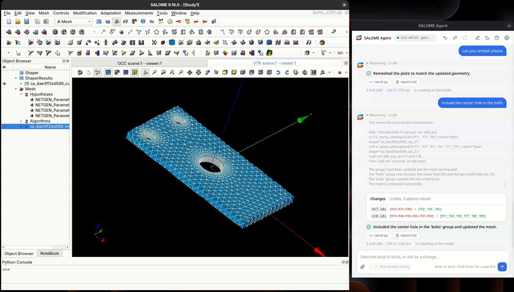

# SALOME Agent

> **Not part of SALOME for the moment.** This plugin is installed separately (see [Install](#install)).

**Chat with SALOME and watch your model take shape!** Describe what you want in plain words, or
drop in a picture of it, and the agent builds it for you, right inside SALOME.

<p align="center">
  <a href="https://www.youtube.com/watch?v=iFKYA-E-_0o">
    
  </a>
  <br>
  <em>Click to watch the presentation on YouTube (in French).</em>
</p>

Built on [salome-agent](https://github.com/bauj/salome-agent), the core engine, which you can also
run from the command line, without the SALOME window.

## What it can do

<p align="center">
  
  <br>
  <em>A plate built in SHAPER and meshed in SMESH, then changed with a follow-up message in the chat.</em>
</p>

SALOME covers the whole simulation workflow; the agent handles **geometry and meshing** today,
through three SALOME modules. One request can use several, for example building a part in SHAPER
and then meshing it in SMESH.

**SHAPER: parametric CAD, used by default**
- Constrained sketches, and basic shapes such as boxes and cylinders
- Extrude, revolve, pipe, loft and filling
- Fuse, cut, common, partition and split
- Fillets, chamfers and groups
- Moves, mirrors, patterns and alignment

**GEOM: CAD, used when your request names it ("using GEOM")**
- Basic shapes, wires and faces
- Prism, revolution, pipe, thick solids and filling
- Fuse, cut, common and partition
- Fillets and chamfers
- Moves, mirrors, patterns and alignment

**SMESH: meshing**
- Tetrahedra, triangles, structured and body-fitted hexahedra, and prisms
- Local sizes and viscous layers
- Groups from the geometry, quality checks and quadratic elements
- Export to MED, UNV, STL (faces only) or CGNS

### How a request becomes a model

1. **Describe it in words or pictures.** You can attach drawings, sketches or photos.
2. **Review the plan.** The agent splits the job into stages and waits for your approval, or runs
   straight through if you turn on batch mode.
3. **Watch it build.** Objects appear in the Object Browser and the 3D viewer as they are made. The
   agent checks each stage, and if one fails, you can give a hint, skip it or abort.
4. **Keep talking to refine it.** "Make the roof taller" changes only that object and what depends
   on it. You can undo and redo each change.

### What you get

- **The objects in your study,** with names starting `sa_` followed by the run's id.
- **`result.py`,** a standalone script that rebuilds everything in SALOME without the agent.
- **`report.md`,** a record of the run.

### Ask the documentation

The same window can also answer questions about SALOME instead of building models. The plugin
adds a **Tools > Plugins > AI tools** submenu with two entries:

| Entry | What it opens |
|---|---|
| **SALOME agent** | The chat window as the **Agentic assistant**: it builds geometry and meshes in your study, as described above, and its settings are the agent's |
| **Documentation (RAG)** | The chat window on the documentation, with a switch at the top between **Classical RAG** (one search, answers from the best passages) and **Agentic RAG** (the model searches and reads pages several times: slower, better at questions that span several pages) |

There is one window: choosing the other entry while it is open moves it there, unless an Agentic
assistant conversation is open (end it first with New conversation, since switching would lose
it). The documentation switch works between questions. The mode is saved as `gui.mode`. Run by
hand (`salome-agent-gui.sh` with no `--mode`), the window offers all three modes.

Each answer lists the pages it was built from, with links to docs.salome-platform.org. Questions
are answered one by one, with no memory of the previous ones, and need no agent server. Both
documentation modes come from [raglib](https://github.com/bauj/rag_and_chatbot), included as
the `raglib` submodule.

They need an index of the SALOME HTML documentation. Build it once with **Build index** in the
settings, or from a terminal. The documentation comes from your SALOME installation, found
through its environment: `$DOCUMENTATION_ROOT_DIR/share/doc/salome/{gui,tui}/<MODULE>`, or each
module's `$<MODULE>_ROOT_DIR` when `DOCUMENTATION_ROOT_DIR` is not set. Run the command in
SALOME's environment (or `export DOCUMENTATION_ROOT_DIR=<SALOME>/INSTALL/DOCUMENTATION`):

```bash
~/SALOME-9.16.0-native-FD44-SRC/salome shell -- \
    ~/.local/share/salome-agent-gui/bin/salome-agent-gui.sh --build-index [config.json]
```

All three modes share one config file, `~/.config/salome/salome-agent.json`, seeded from
[`salome_agent_gui/config.example.json`](salome_agent_gui/config.example.json): `llm` is the
endpoint every mode uses, `salome`/`policy`/`work_dir` are the agent's, `rag` holds raglib's
`chatbot` and `extraction` configs, and `gui.mode` (`agent`, `rag` or `rag_agentic`) picks the
mode. Paths in `rag` expand `~`, `$VAR` and the shell's `${VAR:-fallback}`; relative paths are
relative to the config file.

Both documentation modes also run two small models on your computer: an embedding model, used
by the index build and every search, and a reranker. They are the ones raglib's
`download_models.py` lists. The settings' **Local models** section shows whether each one is in
the Hugging Face cache (`~/.cache/huggingface/hub`, or `$HF_HUB_CACHE`), lets you choose another
one, and has a **Download** button for a missing one. **Build index** downloads a missing embedding
model by itself.

The launcher leaves SALOME's own Python behind, and runs the chat window and the index build from
`~/.local/share/salome-agent/rag`. Set `SALOME_AGENT_GUI_DATA_DIR` to use another directory: that
is where raglib writes its `debug_traces/` when `rag.chatbot.agentic.debug` is on.

### Not there yet

The agent does not set up or run solvers, or post-process results. Always check what it builds:
quality depends on the model you use, especially when reading images.

## Install

There are two ways. Both were tested on the SALOME 9.16.0 package for Fedora 44.

- **The install script** is the quickest, and leaves your SALOME untouched. Not sure? Use this one.
- **SAT** builds the plugin into your SALOME installation.

Either way, you need a SALOME that runs on Python 3.10 or newer, and internet access for GitHub and
PyPI. The install takes about 500 MB, most of it Qt and Chromium: the chat window is a web page
drawn in Qt WebEngine, and SALOME does not provide WebEngine, so a full copy is embedded. The
documentation modes add about 2 GB: CPU-only PyTorch, ChromaDB, and the embedding models
downloaded on first use.

### With the install script

You also need a Python 3.10+ on your system to run the chat window; set `PYTHON` to use a
specific one. The script checks both Python versions for you.

**1. Find your SALOME directory.** It is the directory you unpacked the SALOME package into,
the one holding the `salome` launcher you normally start SALOME with:

```
~/SALOME-9.16.0-native-FD44-SRC/
├── salome
├── env_launch.sh
├── BINARIES-FD44/
└── ...
```

**2. Install**, giving that directory:

```bash
git clone --recursive https://github.com/bauj/salome-agent-gui.git
cd salome-agent-gui
./install.sh ~/SALOME-9.16.0-native-FD44-SRC
```

Everything goes in `~/.local/share/salome-agent-gui` (give another directory as a second
argument). Nothing is written in your SALOME directory. Set `RAG=0` to leave out the
documentation modes (`RAG=0 ./install.sh ...`).

**3. Start SALOME through the launcher the install created:**

```bash
~/.local/share/salome-agent-gui/salome-with-agent
```

Use this launcher every time: your usual `salome` still works, but does not show the plugin.

To update: `git pull`, `git submodule update --init`, then run `install.sh` again.
To uninstall: delete `~/.local/share/salome-agent-gui`.

### With SAT, directly in your SALOME installation

If you prefer to install SALOME Agent directly in your SALOME installation, use SAT
(salomeTools, SALOME's build tool). The plugin then becomes part of that SALOME, and you start it
with its usual `salome` launcher. You need a package that includes SAT: its name ends in `-SRC`.

Run all the commands below from the directory that holds the downloaded package.

**1. Unpack SALOME and prepare it for SAT.** SAT expects the directory to be named
`<application>-<distribution>`, so the `-SRC` suffix has to go. `install_bin.sh` then sets up the
package so that new products can be added to it:

```bash
tar xf SALOME-9.16.0-native-FD44-SRC.tar.gz
mv SALOME-9.16.0-native-FD44-SRC SALOME-9.16.0-native-FD44
(cd SALOME-9.16.0-native-FD44 && ./install_bin.sh)
```

**2. Point SAT at the project that knows salome-agent-gui.** The product is defined in our
[sat_salome fork](https://github.com/bauj/sat_salome/tree/feat/salome-agent-gui):

```bash
git clone -b feat/salome-agent-gui https://github.com/bauj/sat_salome.git SAT_SALOME
cp -r SALOME-9.16.0-native-FD44/sat SAT
SAT/sat init --reset_projects
SAT/sat init --add_project "$PWD/SAT_SALOME/salome.pyconf"
```

**3. Download and build salome-agent-gui.** This one product holds all three assistants, and it
replaces `sarag` (the separate salome-assistant documentation chatbot): leave `sarag` out of the
application, or SALOME shows two menu entries. Set `SALOME_AGENT_GUI_RAG=0` before compiling to
leave out the documentation modes (about 2 GB: CPU-only torch, chromadb, embedding models).

```bash
SAT/sat prepare SALOME-9.16.0-native -p salome_agent_gui
SAT/sat compile SALOME-9.16.0-native -p salome_agent_gui
```

**4. Update the SALOME launcher** so that it knows about the plugin:

```bash
SAT/sat launcher SALOME-9.16.0-native
SAT/sat environ SALOME-9.16.0-native
```

**5. Start SALOME as usual:**

```bash
SALOME-9.16.0-native-FD44/salome
```

To update: close SALOME, run `git pull` and `git submodule update --init` in
`SALOME-9.16.0-native-FD44/SOURCES/salome_agent_gui`, then
`SAT/sat compile SALOME-9.16.0-native -p salome_agent_gui --force`.

## First start

1. Open **Tools > Plugins > AI tools > SALOME agent** (or **Documentation (RAG)**). This opens
   the chat window on that assistant.
2. Click the gear icon and enter your model's **endpoint, API key and model name**.
3. Type what you want to build.

**The agent needs an AI model, which you provide.** It works with any service that offers an
OpenAI-compatible API and supports tool calling, whether hosted (you get an endpoint and an API key
from the provider) or running on your own machine. To work from pictures, the model must also
be able to read images. You can choose a different model for each module in the settings.

## Chat window

- **Images:** use the paperclip, drag and drop, or paste. A *Reading image* card shows the agent
  reading them.
- **Plan:** click *Approve & build*, or *Edit plan* to change it first.
- **Reasoning:** a switch in the settings shows the model's reasoning as it works.
- **Stop** ends the turn in progress. The run still writes its `report.md`.
- **Result line:** each turn ends with a summary and any warnings, such as a value you asked for
  that was kept even though a check disagreed.
- **Rebuild** replays the whole study when it no longer matches the model.

## Settings

The gear icon opens the settings. They show only the options of the mode chosen under
**Assistant** (the same choice as the switch at the top of the window), and they switch as soon
as you pick another mode:

- **Agentic assistant:** the agent server, the model per module, how finely the agent plans, how much
  it checks its work, retries and batch mode.
- **Classical RAG:** the documentation index, the search (reranker, keyword search, title
  boost, passages searched and kept, section context, drafted-answer search) and the answers.
- **Agentic RAG:** the documentation index, the search toggles, the agent's limits
  (steps, characters per page, sections per search) and the answers.

The model endpoint, the theme and the configuration file are shared by every mode. Each option
explains itself in a tooltip.

They are saved in `~/.config/salome/salome-agent.json`. **Load config** switches to another file.
The [configuration reference](https://github.com/bauj/salome-agent/blob/main/docs/configuration.md)
describes every setting of the agent.

The window adds two sections of its own to that file:

- **`gui`:** window options, including `mode`, which can be `agent`, `rag` or `rag_agentic`.
- **`rag`:** raglib's two configurations. `rag.chatbot` holds retrieval, the reranker and the
  `agentic` limits. `rag.extraction` lists the documentation to index. Each follows
  [raglib's own schema](https://github.com/bauj/rag_and_chatbot#readme). Relative paths are read
  from the config file's directory, and `~` and `$VARIABLES` are expanded. Leave out
  `rag.chatbot.llm` to use the model above, or set some of its keys to override that model.

Every mode's settings live in that one file. A config file from before the documentation modes
gets the `rag` section from `salome_agent_gui/config.example.json` when the window starts
(`"rag": null` is left alone). Turning the reranker off keeps its block under
`rag.chatbot._reranker_off`, so turning it back on restores your model.

## Development

```bash
python3 -m venv .venv && .venv/bin/pip install -e ./salome-agent -e '.[dev]'
QT_QPA_PLATFORM=xcb .venv/bin/python -m pytest   # all tests; needs a display
# the documentation modes for real (CPU torch first):
.venv/bin/pip install torch --index-url https://download.pytorch.org/whl/cpu
.venv/bin/pip install -c constraints.txt -e '.[rag,dev]'
```

The page tests (marker `web`) need Qt WebEngine and a real display; with
`QT_QPA_PLATFORM=offscreen` or no `DISPLAY` they are skipped and the rest still run.
`tools/render_states.py OUTDIR` renders the page's states to PNG for review.
Python dependencies are pinned by `constraints.txt`.

The `salome-agent` submodule pins the engine, and `raglib` pins the documentation chatbot. After
bumping either one, check that `git ls-tree HEAD salome-agent raglib` shows the intended commits.
The wheel ships raglib's sources as `salome_agent_gui/_raglib/`.

## License

GNU Lesser General Public License, version 2.1 or later: see `COPYING`.
