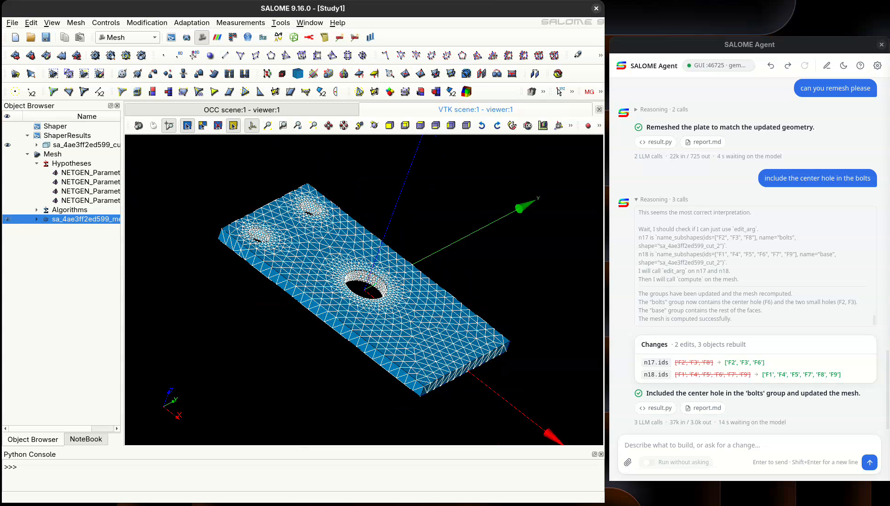

# SALOME Agent

> **Not part of SALOME for the moment.** This plugin is installed separately (see [Install](#install)).

**Chat with SALOME and watch your model take shape!** Describe what you want in plain words, or
drop in a picture of it, and the agent builds it for you, right inside SALOME.

<p align="center">
  <a href="https://www.youtube.com/watch?v=iFKYA-E-_0o">
    
  </a>
  <br>
  <em>Click to watch the presentation on YouTube (in French).</em>
</p>

Built on [salome-agent](https://github.com/bauj/salome-agent), the core engine, which you can also
run from the command line, without the SALOME window.

## What it can do

<p align="center">
  
  <br>
  <em>A plate built in SHAPER and meshed in SMESH, then changed with a follow-up message in the chat.</em>
</p>

SALOME covers the whole simulation workflow; the agent handles **geometry and meshing** today,
through three SALOME modules. One request can use several, for example building a part in SHAPER
and then meshing it in SMESH.

**SHAPER: parametric CAD, used by default**
- Constrained sketches, and basic shapes such as boxes and cylinders
- Extrude, revolve, pipe, loft and filling
- Fuse, cut, common, partition and split
- Fillets, chamfers and groups
- Moves, mirrors, patterns and alignment

**GEOM: CAD, used when your request names it ("using GEOM")**
- Basic shapes, wires and faces
- Prism, revolution, pipe, thick solids and filling
- Fuse, cut, common and partition
- Fillets and chamfers
- Moves, mirrors, patterns and alignment

**SMESH: meshing**
- Tetrahedra, triangles, structured and body-fitted hexahedra, and prisms
- Local sizes and viscous layers
- Groups from the geometry, quality checks and quadratic elements
- Export to MED, UNV, STL (faces only) or CGNS

**Beyond building**
- **Use your own AI client:** Claude Code, Codex, Gemini CLI, Claude Desktop or another MCP client
  can build in SALOME with the same tools (see [MCP](#use-it-from-claude-code-gemini-cli-or-claude-desktop-mcp))

### How a request becomes a model

1. **Describe it in words or pictures.** You can attach drawings, sketches or photos.
2. **Review the plan.** The agent splits the job into stages and waits for your approval, or runs
   straight through if you turn on batch mode.
3. **Watch it build.** Objects appear in the Object Browser and the 3D viewer as they are made. The
   agent checks each stage, and if one fails, you can give a hint, skip it or abort.
4. **Keep talking to refine it.** "Make the roof taller" changes only that object and what depends
   on it. You can undo and redo each change.

### What you get

- **The objects in your study,** with names starting `sa_` followed by the run's id.
- **`result.py`,** a standalone script that rebuilds everything in SALOME without the agent.
- **`report.md`,** a record of the run.

### The AI tools menu

The plugin adds a **Tools > Plugins > AI tools** submenu with two entries:

| Entry | What it opens |
|---|---|
| **SALOME agent** | The chat window: it builds geometry and meshes in your study, as described above |
| **MCP server** | A server that Claude Code, Gemini CLI, Antigravity (`agy`) or another MCP client connects to, and a small window with the commands that connect them: see [Use it from an MCP client](#use-it-from-claude-code-gemini-cli-or-claude-desktop-mcp) |

### Not there yet

The agent does not set up or run solvers, or post-process results. Always check what it builds:
quality depends on the model you use, especially when reading images.

## Install

There are two ways. Both were tested on the SALOME 9.16.0 package for Fedora 44.

- **The install script** is the quickest, and leaves your SALOME untouched. Not sure? Use this one.
- **SAT** builds the plugin into your SALOME installation.

Either way, you need a SALOME that runs on Python 3.10 or newer, and internet access for GitHub and
PyPI. The install takes about 500 MB, most of it Qt and Chromium: the chat window is a web page
drawn in Qt WebEngine, and SALOME does not provide WebEngine, so a full copy is embedded.

### With the install script

You also need a Python 3.10+ on your system to run the chat window; set `PYTHON` to use a
specific one. The script checks both Python versions for you.

**1. Find your SALOME directory.** It is the directory you unpacked the SALOME package into,
the one holding the `salome` launcher you normally start SALOME with:

```
~/SALOME-9.16.0-native-FD44-SRC/
├── salome
├── env_launch.sh
├── BINARIES-FD44/
└── ...
```

**2. Install**, giving that directory:

```bash
git clone --recursive https://github.com/bauj/salome-agent-gui.git
cd salome-agent-gui
./install.sh ~/SALOME-9.16.0-native-FD44-SRC
```

Everything goes in `~/.local/share/salome-agent-gui` (give another directory as a second
argument). Nothing is written in your SALOME directory.

**3. Start SALOME through the launcher the install created:**

```bash
~/.local/share/salome-agent-gui/salome-with-agent
```

Use this launcher every time: your usual `salome` still works, but does not show the plugin.

To update: `git pull`, `git submodule update --init`, then run `install.sh` again.
To uninstall: delete `~/.local/share/salome-agent-gui`.

### With SAT, directly in your SALOME installation

If you prefer to install SALOME Agent directly in your SALOME installation, use SAT
(salomeTools, SALOME's build tool). The plugin then becomes part of that SALOME, and you start it
with its usual `salome` launcher. You need a package that includes SAT: its name ends in `-SRC`.

Run all the commands below from the directory that holds the downloaded package.

**1. Unpack SALOME and prepare it for SAT.** SAT expects the directory to be named
`<application>-<distribution>`, so the `-SRC` suffix has to go. `install_bin.sh` then sets up the
package so that new products can be added to it:

```bash
tar xf SALOME-9.16.0-native-FD44-SRC.tar.gz
mv SALOME-9.16.0-native-FD44-SRC SALOME-9.16.0-native-FD44
(cd SALOME-9.16.0-native-FD44 && ./install_bin.sh)
```

**2. Point SAT at the project that knows salome-agent-gui.** The product is defined in our
[sat_salome fork](https://github.com/bauj/sat_salome/tree/feat/salome-agent-gui):

```bash
git clone -b feat/salome-agent-gui https://github.com/bauj/sat_salome.git SAT_SALOME
cp -r SALOME-9.16.0-native-FD44/sat SAT
SAT/sat init --reset_projects
SAT/sat init --add_project "$PWD/SAT_SALOME/salome.pyconf"
```

**3. Download and build salome-agent-gui:**

```bash
SAT/sat prepare SALOME-9.16.0-native -p salome_agent_gui
SAT/sat compile SALOME-9.16.0-native -p salome_agent_gui
```

**4. Update the SALOME launcher** so that it knows about the plugin:

```bash
SAT/sat launcher SALOME-9.16.0-native
SAT/sat environ SALOME-9.16.0-native
```

**5. Start SALOME as usual:**

```bash
SALOME-9.16.0-native-FD44/salome
```

To update: close SALOME, run `git pull` and `git submodule update --init` in
`SALOME-9.16.0-native-FD44/SOURCES/salome_agent_gui`, then
`SAT/sat compile SALOME-9.16.0-native -p salome_agent_gui --force`.

## First start

1. Open **Tools > Plugins > AI tools > SALOME agent**. This opens the chat window.
2. Click the gear icon and enter your model's **endpoint, API key and model name**.
3. Type what you want to build.

**The agent needs an AI model, which you provide.** It works with any service that offers an
OpenAI-compatible API and supports tool calling, whether hosted (you get an endpoint and an API key
from the provider) or running on your own machine. To work from pictures, the model must also
be able to read images. You can choose a different model for each module in the settings.

## Chat window

- **Images:** use the paperclip, drag and drop, or paste. A *Reading image* card shows the agent
  reading them.
- **Plan:** click *Approve & build*, or *Edit plan* to change it first.
- **Reasoning:** a switch in the settings shows the model's reasoning as it works.
- **Stop** ends the turn in progress. The run still writes its `report.md`.
- **Result line:** each turn ends with a summary and any warnings, such as a value you asked for
  that was kept even though a check disagreed.
- **Rebuild** replays the whole study when it no longer matches the model.

## Settings

The gear icon opens the settings: your model, how finely the agent plans, how much it checks its
work, retries, batch mode and theme. Each option explains itself in a tooltip.

They are saved in `~/.config/salome/salome-agent.json`. **Load config** switches to another file.
The [configuration reference](https://github.com/bauj/salome-agent/blob/main/docs/configuration.md)
describes every setting.

## Use it from Claude Code, Gemini CLI or Claude Desktop (MCP)

`salome-agent-mcp` gives an AI client the SALOME Agent's tools through the
[Model Context Protocol](https://modelcontextprotocol.io). The client's own model holds the
conversation and does the planning, under the plan you already use it with (a Claude plan for
Claude Code or Claude Desktop, a ChatGPT plan for Codex, a Google account for Gemini CLI, ...):
nothing here calls a model, and no API key is needed. It talks to the agent server of the
SALOME you have open, like the chat window does.

| Tool | What it does |
|---|---|
| `list_cad_tools`, `describe_cad_tool`, `call_cad_tool` | The 132 GEOM, SHAPER and SMESH tools, with each module's guide |
| `calc` | The engine's arithmetic sandbox |
| `view_salome`, `list_study`, `show_objects`, `hide_objects`, `delete_objects` | Look at and tidy the study |
| `save_salome_script` | A standalone `result.py` that rebuilds what Claude built |
| `release_salome` | Hands the agent server back to the chat window |

1. Start SALOME and open **Tools > Plugins > AI tools > MCP server**. That starts the agent
   server and an MCP server waiting for clients on `http://127.0.0.1:47801/mcp`, and opens a
   small window with the command that registers it in each client:

   ```bash
   claude mcp add --scope user --transport http salome-agent http://127.0.0.1:47801/mcp --header "Authorization: Bearer <token>"
   gemini mcp add --scope user --transport http --header "Authorization: Bearer <token>" salome-agent http://127.0.0.1:47801/mcp
   agy mcp add --header "Authorization: Bearer <token>" salome-agent http://127.0.0.1:47801/mcp
   ```

   Keep the options where they are: `agy` rejects any option after the name and has no
   `--transport` (it recognises the http URL), and `claude`'s `--header` takes several values,
   so it comes last.

   Register it once: the port and the token are kept in `~/.local/share/salome-agent/mcp-http.json`
   (change `port` there if 47801 is taken). Closing the window leaves the server running; it
   stops with SALOME or with the window's Stop server button, and logs to
   `~/.local/share/salome-agent/salome-agent-mcp.log`. Keep the chat window out of a
   conversation while a client builds: the agent server serves one client at a time.
   Each MCP client gets its own session, and a second one that asks while the first holds the
   agent server is told it is busy. A session left 15 minutes without a SALOME call is released,
   so the chat window can use the server again: the next call says so, and the objects built
   before stay in the study but can no longer be referred to by name. `save_salome_script`
   writes to the session's folder, or to a new `.py` file you name; it never overwrites a file
   it did not write.
   Outside SALOME, `salome-agent-gui.sh --mcp --http [--port N]` runs the same server.
2. Claude Desktop starts its own server over stdio instead. Print its entry and merge it into its `claude_desktop_config.json`
   (Claude Desktop: Settings > Developer > Edit Config):

   ```bash
   ~/.local/share/salome-agent-gui/bin/salome-agent-mcp --desktop-config
   ```

   Under WSL the entry starts the server through `wsl.exe`. Quit Claude Desktop completely (tray
   icon > Quit) before editing the file, since it rewrites the file while it runs, then start it
   again. The Microsoft Store build of Claude Desktop does not read
   `%APPDATA%\Claude\claude_desktop_config.json`; it reads
   `%LOCALAPPDATA%\Claude-Data\claude_<id>\claude_desktop_config.json`. Its logs are in
   `%LOCALAPPDATA%\Claude\Logs\main.log`; "no stdio servers connected" there means the entry is
   in a file it does not read.
3. `salome-agent-mcp --check` prints what Claude will find (agent server, tools).

Claude Code can also start its own server over stdio, without the menu's:
`claude mcp add salome-agent -- ~/.local/share/salome-agent-gui/bin/salome-agent-mcp`.

## Development

```bash
python3 -m venv .venv && .venv/bin/pip install -e ./salome-agent -e '.[dev]'
QT_QPA_PLATFORM=xcb .venv/bin/python -m pytest   # all tests; needs a display
```

The page tests (marker `web`) need Qt WebEngine and a real display; with
`QT_QPA_PLATFORM=offscreen` or no `DISPLAY` they are skipped and the rest still run.
`tools/render_states.py OUTDIR` renders the page's states to PNG for review.
Python dependencies are pinned by `constraints.txt`.

The `salome-agent` submodule pins the engine; after bumping it, check that
`git ls-tree HEAD salome-agent` shows the intended engine commit.

## License

GNU Lesser General Public License, version 2.1 or later: see `COPYING`.
