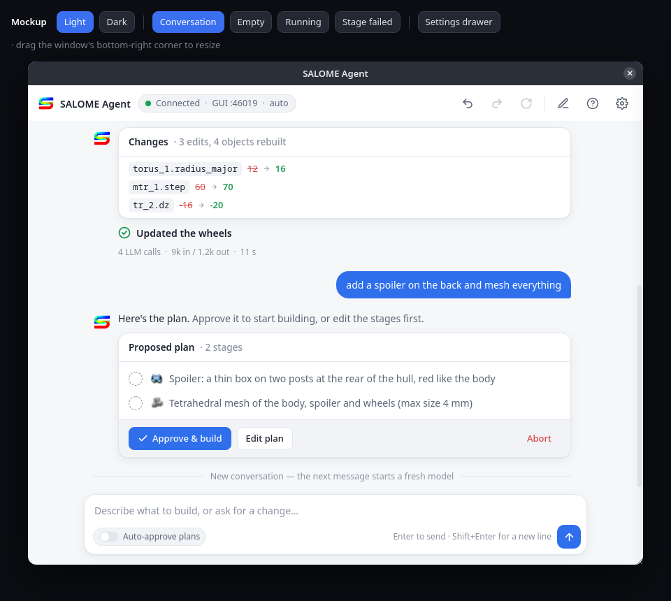
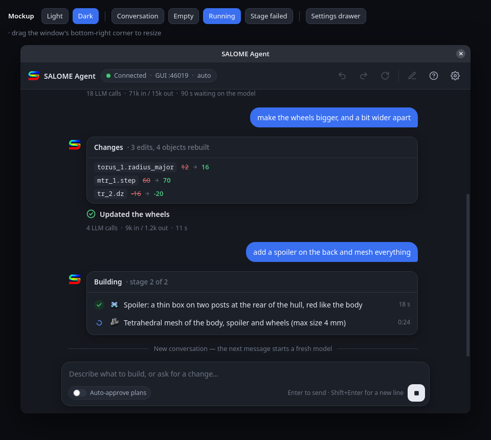
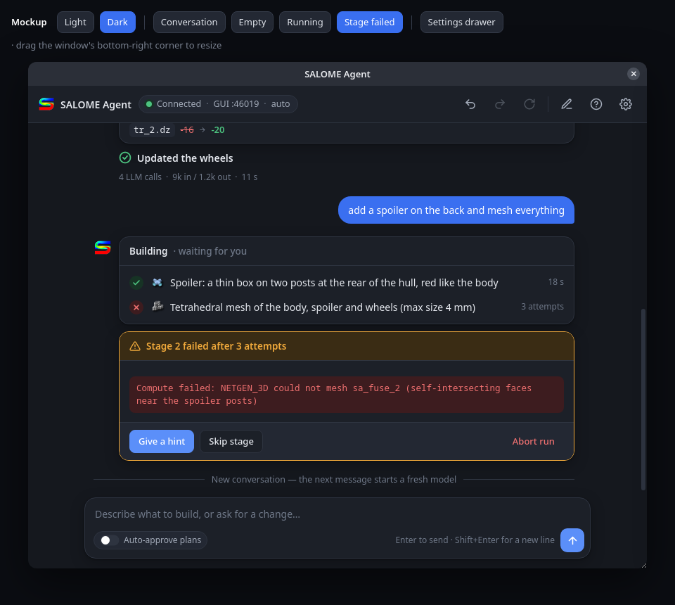
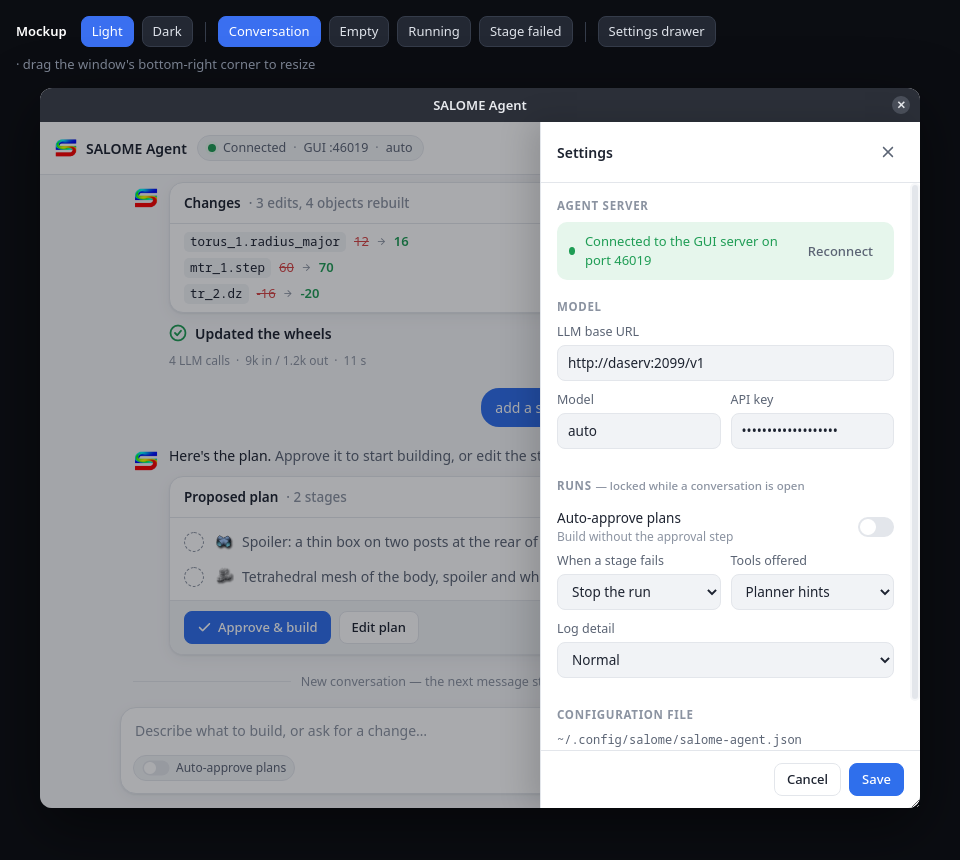

# Modern chat UI for salome-agent-gui — design

Date: 2026-09-23. Covers tasks 248 (settings out of the permanent left panel),
249 (transcript polish), task 245 items 4, 5 and 7, and the per-turn usage part of 258.

## Goal

Replace the current window, a settings form on the left plus a markdown
`QTextBrowser` and a row of nine equal buttons, with a modern chat interface:
the conversation fills the window, the user's messages and the agent's replies
look different, plans and stage progress are cards, settings live behind a gear.

The approved look is the mockup in
[`2026-09-23-modern-chat-ui/chat-mockup.html`](2026-09-23-modern-chat-ui/chat-mockup.html)
with its screenshots in the same folder. The mockup's CSS is the starting point
for the product stylesheet. To see the module icons in the mockup, copy
`$GEOM_ROOT_DIR/share/salome/resources/geom/ModuleGeom.png` to `geom.png` and
`$SMESH_ROOT_DIR/share/salome/resources/smesh/ModuleMesh.png` to `smesh.png`
next to it; they are deliberately not committed.

| | |
|---|---|
|  |  |
|  |  |

## Decisions

- **Stays a separate window, not a SALOME dock** (task 250 stays open). The chat
  keeps running as its own process in its own venv, as decided in session 38;
  a dock would move the agent and its dependencies into SALOME's process.
- **Drawn as a web page** in a `QWebEngineView`. Chosen over native Qt widgets
  and over restyling the `QTextBrowser`: the most freedom for a modern look.
  Cost accepted: PyQtWebEngine (Chromium 87) in the product venv, about 390 MB
  for the Qt directory.
- **Logo**: the SALOME "S" (`web/salome-s.png`, cut out from the salome-platform
  GitHub avatar, 176 px, transparent background) in the header, as the agent's
  avatar, and on the welcome screen.
- **Module icons instead of "GEOM"/"SMESH" text** on plan steps, loaded at runtime
  from the SALOME install (see Module icons).
- **Edit plan and edit config JSON stay native** `JsonEditDialog` popups.
  An HTML plan editor adds nothing yet.
- **No engine (salome-agent) changes.** Data the engine does not send is either
  derived in the GUI (short object names, stage times) or left out (colour
  swatches and friendly part names such as "wheel 1").

Feasibility was checked before choosing: `PyQtWebEngine==5.15.7` with
`PyQtWebEngine-Qt5==5.15.19` matches the venv's `PyQt5-Qt5==5.15.19`; in a
scratch venv it loaded, rendered CSS and called back from JavaScript into Python.

## Architecture

```
MainWindow (QMainWindow, thin shell)
 └─ QWebEngineView ── loads salome_agent_gui/web/index.html (local files only)
       ▲  QWebChannel
       ▼
    Bridge (QObject) ── owns ConversationWorker, the RunViews, settings, status
       ├─ timeline.RunView.apply(event) / .to_view_model()
       ├─ config_store (unchanged)
       ├─ ConversationWorker (unchanged)
       └─ agent_server.handshake.live_owner probe (unchanged)
```

- **Python owns all state; the page only draws it.** Worker events go into
  `RunView.apply()` as today; `RunView.to_view_model()` produces plain JSON that
  the page renders. The page never interprets engine events.
- **Files**
  - `salome_agent_gui/web/index.html`, `app.css`, `app.js`, `salome-s.png`,
    shipped as package data. `qwebchannel.js` comes from Qt's own resource
    (`qrc:///qtwebchannel/qwebchannel.js`). No network, no CDN.
  - `salome_agent_gui/bridge.py`: the `Bridge` QObject.
  - `salome_agent_gui/module_icons.py`: module icon lookup.
  - `salome_agent_gui/main_window.py`: shrinks to the shell (web view, bridge
    wiring, parent-process watch, close handling).
  - `salome_agent_gui/chat_view.py`: deleted (the `QTextBrowser` goes away).
  - `salome_agent_gui/timeline.py`: `render_*` markdown functions replaced by
    `to_view_model()`.

### Bridge API

Page to Python (slots):

| call | effect |
|---|---|
| `ready()` | page loaded; Python flushes queued pushes |
| `send(text)` | start or continue the conversation |
| `gate(gate_id, action, text)` | answer a gate: `approve`, `abort`, `skip`, `hint` (with `text`), `edit` (opens the native plan dialog) |
| `command(name)` | `undo`, `redo`, `rebuild`, `new` |
| `stop()` | stop the current turn |
| `openFile(path)` | open `result.py` / `report.md` with the desktop |
| `saveSettings(json)` | save base URL, model, API key, run options, theme |
| `editConfigJson()` | open the native JSON editor on the config file |
| `reconnect()` | probe the agent server again |

Python to page (one signal, `push(name, json)`, dispatched in `app.js`):
`addUser`, `renderTurn(id, vm)`, `addNote`, `setBusy`, `setStatus`,
`setSettings`, `setTheme`, `reset` (clear transcript), `replay` (full
transcript after a page reload).

### View model (one per agent turn)

```json
{
  "id": 3,
  "stages": [{"index": 0, "module": "geom", "icon": "file:///…/ModuleGeom.png",
              "intent": "…", "status": "pending|running|ok|failed|skipped",
              "attempts": 1, "started_at": 1790168136.2, "elapsed_s": 12.1,
              "error": null}],
  "edits": [{"op": "edit", "node": "torus_1", "param": "radius_major",
             "old": "12", "new": "16"}],
  "gate": null,
  "status": "running|ok|needs_input|failed|degraded|ended|aborted|fatal",
  "message": "…",
  "objects": ["fuse_1", "mtr_1_solid_1"],
  "files": {"result_py": "/…/result.py", "report_md": "/…/report.md"},
  "usage": {"calls": 18, "prompt_tokens": 70819, "completion_tokens": 14763,
            "llm_seconds": 90.2}
}
```

- `gate`: `{"id": 7, "kind": "plan"}` or
  `{"id": 8, "kind": "stage_failed", "stage": 1, "message": "…", "line": 12}`.
  Gate ids increase per window; an answer with an old id is ignored.
- `edits` also carries `{"op": "delete", "nodes": [...]}`,
  `{"op": "add", "node": …, "new": …}` and `{"op": "replay", "nodes": [...]}`.
- `objects`: names with the `sa_<run_id>_` prefix removed.
- `usage`: this turn only. Python subtracts the previous turn's totals from the
  cumulative `llm.usage` the engine reports (task 258).
- `elapsed_s` is measured by the GUI between `stage_start` and `stage_done`;
  while a stage runs the page shows a live counter from `started_at`.

### Module icons

`module_icons.icon_for(module)` reads `$<MODULE>_ROOT_DIR` (for example
`GEOM_ROOT_DIR`), then the `icon` parameter of that module's
`share/salome/resources/<module>/SalomeApp.xml` (GEOM: `ModuleGeom.png`, SMESH:
`ModuleMesh.png`, PARAVIS: `pqAppIcon22.png`), and returns a `file://` URL, or
`None` when anything is missing; the page then shows the text badge. The chat
process inherits these variables from SALOME (checked on a live process). No
install path is written in the code.

### Theme

Setting `theme`: `system` (default), `light`, `dark`, saved as `gui.theme` in
the same `salome-agent.json` (the agent checks only `llm.*` key names, so a
top-level `gui` section is ignored by it). `system` is decided in
Python from the Qt palette's window colour lightness and sent with `setTheme`;
Chromium 87 does not follow the desktop theme reliably. CSS must stay within
what Chromium 87 supports (no `color-mix()`, no `:has()`).

## Flow

**Start-up.** Python creates the web view and loads `index.html`; pushes made
before `ready()` are queued and flushed on it. Python then sends settings,
theme, status, and the empty state. Server polling stays as today (every second
for up to 10 s; the drawer's Reconnect probes again).

**A turn.**
1. `send(text)`: Python refuses unless connected and not busy; starts a
   `ConversationWorker` on the first message, with the current settings.
2. Python pushes `addUser`, creates a `RunView` with a new id, pushes
   `setBusy(true)`. The page turns Send into Stop and disables the header icons.
3. Each worker event: `RunView.apply()`, then `renderTurn(id, to_view_model())`.
   Only that turn is redrawn.
4. `gate`: the view model gets a gate with a new id. Approve, Abort and Skip go
   straight to the worker. Hint: the card's "Give a hint" button opens a text box
   inside the card; its Send answers with the text. Edit plan opens the native
   dialog and answers with the edited plan, or does nothing on Cancel.
5. `turn_done`: final status, objects, files, per-turn usage; `setBusy(false)`;
   probe the server again.

**Commands** (undo, redo, rebuild, new conversation) work as today; their
results appear as notes. **Settings**: Save writes through `config_store`; run
options are disabled in the page while a conversation is open and Python also
refuses them.

## Errors and edge cases

- **Engine and LLM text is never inserted as HTML.** Stage intents, errors,
  messages and object names are set with `textContent` (or built with DOM
  calls), so model output cannot inject markup or script.
- **Multi-line errors** are shown in a monospace block (245 item 4).
- **Aborted and failed runs keep their `result.py` / `report.md` chips**
  (245 item 5).
- **No agent server:** red status pill ("Not connected"), Send disabled, a banner
  saying how to start the server from the Plugins menu. A connection lost during
  a turn turns the pill red and puts the error on the turn card.
- **Page crash** (`renderProcessTerminated`): Python reloads the page and pushes
  `replay` with the whole transcript from its own state.
- **WebEngine fails to start** (import error, sandbox or GPU problem): the window
  shows a native error panel naming the fixes (`QTWEBENGINE_DISABLE_SANDBOX=1`,
  `QTWEBENGINE_CHROMIUM_FLAGS=--disable-gpu`).
- **Closing during a turn does not block the UI** (245 item 7): the window asks
  the worker to stop, shows "Stopping…", ignores the close, and closes when the
  worker finishes.
- **SALOME exits:** unchanged; the parent-process watch closes the window.

## Packaging

- `pyproject.toml`: add `PyQtWebEngine==5.15.7` and `PyQtWebEngine-Qt5==5.15.19`;
  add `web/*` to package data.
- The SAT compile script already installs from `pyproject.toml`
  (`pip3 install ./salome-agent .`), so `sat compile salome_agent_gui` picks the
  new dependency up with no script change.

## Testing

**Python unit tests** (normal suite, no browser):
- `RunView.to_view_model()` over event sequences: plan and stage statuses,
  attempts, gate ids, stage times with an injected clock, prefix-stripped object
  names, per-turn usage from cumulative totals, aborted and failed runs keeping
  their files, a multi-line error kept whole.
- `module_icons`: a temporary directory as `$GEOM_ROOT_DIR` with a small
  `SalomeApp.xml`; variable missing, file missing, unknown module.
- `Bridge` with a fake worker: send refused while busy or disconnected, stale
  gate id ignored, run options refused while a conversation is open, pushes
  queued before `ready()` and flushed after, close during a turn not blocking.
- Existing tests: `test_timeline` updated, `test_main_window` retargeted to the
  bridge, `test_chat_view` deleted.

**Page tests** (real QtWebEngine with pytest-qt, marker `web`, skipped when
WebEngine or a display is missing): load `index.html`, push fixture view models,
read the DOM back with `runJavaScript` (text, buttons, busy state, Send/Stop).
Injection test: an intent of `` renders as text and
creates no `img`. Clicking Approve and Hint in the page reaches Python.

**Visual check**: `tools/render_states.py` renders fixture states (empty,
conversation, running, failed, settings; light and dark) to PNG for review
without SALOME.

**Live check in SALOME master**: `sat compile salome_agent_gui`; confirm
WebEngine is in the product venv; launch with `QT_QPA_PLATFORM=xcb ./salome`;
from the Plugins menu run the car request end to end: plan card and Approve,
live stages with module icons and timers, result chips opening the files, a
follow-up edit, Undo and Redo, Stop during a turn, settings saved and still
there after reopening, dark theme, the no-server state, closing during a turn.
Screenshot each step, then the user's own click-through before merging.
SALOME 9.16 is not covered by this check; its SAT product would need a rebuild.

## Out of scope

- The dock inside SALOME (task 250).
- Colour swatches and friendly part names in the object list (needs the engine
  to send labels and colours).
- An HTML plan editor.
- Remaining task 245 items (6: engine-side timing in the report event,
  8–10) and task 258 items 1–4.
